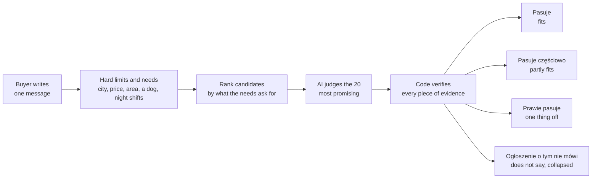
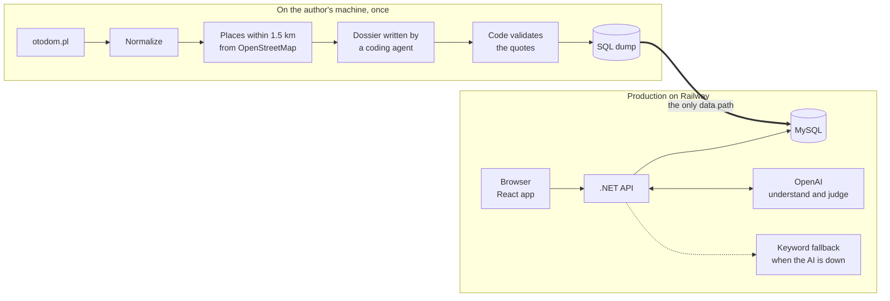

# Flatplanner

A flat listings portal for the Tricity (Gdańsk, Gdynia, Sopot), sales only, where the buyer describes their life in their own words and the portal says which flats fit, partly fit, or leave the question open, each verdict backed by evidence.

**Try it live: https://flatplanner-production.up.railway.app** (the interface and every answer are in Polish)

**Read the one-pager:** [English](docs/one-pager.md) · [Polski](docs/one-pager-pl.md)

## What this is and why

**The problem.** A listing's fields do not answer what decides a purchase. In the 197 listings used here the maintenance fee is filled in for 40%, the lift for 66%, and the surroundings for none. Buyers think in needs ("I work nights and sleep in the day", "my mother uses a wheelchair"), not in fields, and no filter catalogue covers every life situation.

**What the product does.**
- **Once, at import:** every listing gets a *dossier*: a short summary, the buyer risks its description admits to (extra costs, legal status, noise, fields that contradict the text), each backed by a quote, and the places within 1.5 km from OpenStreetMap. 135 risks were kept; 2 were dropped because the description did not support them.
- **At question time:** the buyer writes one message. The portal pulls out the hard limits (city, price, area) and the needs behind them, then rates listings against each need: fits, partly, does not fit, or the listing does not say. Every rating shows its evidence: a quote, a nearby place with its distance, or a field. A rating without evidence becomes "the listing does not say".
- **The result:** listings come back grouped by how well they fit the buyer, with the reason next to each. If the AI is unavailable, keyword search still answers.

**The goal.** This is a prototype built for the Docplanner recruitment task. It shows product reasoning: which gap in the data matters, where AI earns its place, what the key assumption is and how it would be measured. The business case is that a buyer who sees listings judged against their own situation reaches a seller better qualified, and a better-qualified lead is what a portal's advertisers pay for. That link is a hypothesis, not a result: the prototype records no events.

## Where to read more

**Start with the one-pager.** It is the shortest way to see the reasoning: which data, where and why AI, the key assumption, the success metric, how it can fail and what comes next.

- [One-pager (English)](docs/one-pager.md)
- [One-pager (Polski)](docs/one-pager-pl.md)

| Document | Contents |
|---|---|
| [docs/product-scope.md](docs/product-scope.md) | who it is for, features and acceptance criteria, deliberate cuts |
| [docs/ingest-report.md](docs/ingest-report.md) | the numbers behind the one-pager: fill rates, flags, rent gaps |
| [docs/design.md](docs/design.md) | implementation design: data model, API contract, AI pipeline, tests, deploy |
| [docs/ui-spec.md](docs/ui-spec.md) | UI layout, components, states, Polish interface texts |
| [docs/README.md](docs/README.md) | index of the documents above |

The documentation is in English except the Polish one-pager.

## Try it

Open [the live app](https://flatplanner-production.up.railway.app) and paste one of these into the chat on the home page. The chat answers in a few seconds, accepts 5 questions per minute per IP, and takes messages up to 300 characters. Its thread is not in the URL, so a question cannot be shared as a link.

| Say | What it shows |
|---|---|
| `mam psa i pracuję na nocki, 2 pokoje w Gdańsku do 700 tys.` | needs (a dog, sleeping by day) judged per listing, grouped by fit, each verdict with a quote or a nearby place |
| `Jestem z Ukrainy, szukam mieszkania w starej kamienicy z osobnym pokojem na biuro` | domain knowledge in the judge: a foreign buyer's permit rules, checked against ownership and the description |
| `2 pokoje w Krakowie` | the portal serves only Gdańsk, Gdynia and Sopot and says so; the task's Kraków example therefore runs on Gdańsk |

Listings worth opening, each with a "Na co uważać" box of risks quoted from the description:
- [Listing 70](https://flatplanner-production.up.railway.app/listings?listing=70): parking and storage cost 40 000 zł extra, and a bank mortgage is repaid from the price.
- [Listing 97](https://flatplanner-production.up.railway.app/listings?listing=97): the field says 3 rooms, the land register 2 plus a kitchen; the rent is 450 zł, 900 zł in winter.
- [Listing 166](https://flatplanner-production.up.railway.app/listings?listing=166): a cooperative right, and foreigners can buy it without the MSWiA permit.

Prefer filters? The [classic list](https://flatplanner-production.up.railway.app/listings?cities=gdansk&areaMin=40&areaMax=80) has them, and they live in the URL, so a search can be shared.

## How a question is answered



In plain terms:

1. **Understand.** One AI call turns the message into hard limits and up to four needs, checked against a strict schema. If it fails, a keyword parser answers instead, never an error page.
2. **Rank, then judge.** Code ranks listings by how close the places the need asks for are (a school "near", a main road "far") and by keywords in the description. The AI reads only the 20 most promising, so cost and wait do not grow with the number of listings; "Sprawdź kolejne ogłoszenia" loads the next 20. Details: [design.md §16.9](docs/design.md).
3. **Verify.** The AI judges, code verifies. A quote must appear in the listing text, a place must be a real entry in the listing's nearby list, a field must exist. Anything that cannot be verified becomes "the listing does not say". Hard filters, grouping and distances are plain code.

## Under the hood

### Architecture



The import never runs in production: the database there is filled only from the dump. The dossiers are written by a coding agent in a session from a versioned prompt, so they cost no API calls.

### Tech stack

| Layer | Technology |
|---|---|
| Backend | C#, .NET 9, ASP.NET Core Minimal API, EF Core 9 with the Pomelo MySQL provider |
| Database | MySQL 8.4 |
| Frontend | React 19, TypeScript, Vite, React Router, TanStack Query, Leaflet for the map |
| AI | OpenAI API (`gpt-5.6-luna` by default) with strict structured output; the answer streams to the browser; prompts are versioned files in `prompts/` |
| Data | otodom.pl listings, OpenStreetMap (Overpass) for nearby places, a coding agent for the dossiers |
| Tests and CI | xUnit (no network, database or model), GitHub Actions |
| Run and deploy | Docker Compose locally, Railway in production |

Why C#: the stack is allowed by the task and matches the team's, and it keeps the verification code (evidence checks, distances, grouping) strongly typed and testable without the model.

## Data

197 flat-sale listings fetched once from otodom.pl (Gdańsk, Gdynia, Sopot). Demo use only. Sellers' contact details are stripped on import, the data is not committed to this repository and not indexed, and every listing links back to its otodom page.

## Run it locally

You do not need an OpenAI API key. With `CHAT_MODE=fallback` (the default in `.env.example`) the app runs fully: the list, filters, listing details, and the risks and nearby places from the dossier all work. Only the AI chat pipeline (needs understood, per-listing verdicts, grouping) is off; the chat then shows the notice "AI chwilowo niedostępne" with the results of basic filters. To turn the AI on, set `CHAT_MODE=llm` and `OPENAI_API_KEY` in `.env`; a missing key then stops the API at startup.

Requirements: Docker with Compose. For development and checks also the .NET SDK from [`global.json`](global.json) and Node 22.

**1. Configure.**

```bash
cp .env.example .env
```

In `.env` set `MYSQL_ROOT_PASSWORD` and `MYSQL_PASSWORD`, and keep the password inside `ConnectionStrings__Default` equal to `MYSQL_PASSWORD`.

**2. Start.**

```bash
docker compose up -d --build
```

The app is at http://localhost:8080 and `/api/health` returns `db: ok`. The schema is created at startup; the database is empty until you load the data.

**3. Load the data.** `data/` is not in git, so the dump is not in the repository: ask the author for `flatplanner-data.sql`, put it in `data/dumps/`, then:

```bash
set -a; source .env; set +a
docker compose exec -T -e MYSQL_PWD="$MYSQL_ROOT_PASSWORD" mysql mysql -uroot --default-character-set=utf8mb4 flatplanner < data/dumps/flatplanner-data.sql
```

Check: `SELECT COUNT(*) FROM listings;` returns 197.

**Development mode.**

```bash
docker compose up -d mysql
dotnet tool restore
set -a; source .env; set +a
PROMPTS_DIR=../../prompts dotnet run --project src/Flatplanner.Api --urls http://localhost:5080
```
```bash
cd web && npm ci && npm run dev
```

The Vite dev server is at http://localhost:5173 and proxies `/api` to the API on port 5080.

**Checks** (CI runs the same on every pull request; the tests use no network, database or model).

```bash
dotnet format Flatplanner.sln --verify-no-changes
dotnet build Flatplanner.sln
dotnet test Flatplanner.sln
```
```bash
cd web && npm run lint && npm run build
```

**Rebuilding the data instead of loading a dump** (the listings fetched today will differ from the demo set): run the Ingest commands `scrape`, `normalize`, `nearby`, `export-dossiers`, each as `dotnet run --project src/Flatplanner.Ingest -- <command>`. Then have a coding agent write `data/agent/dossiers.jsonl` from `data/agent/listings.jsonl` following [`prompts/listing-dossier.v2.md`](prompts/listing-dossier.v2.md), and finish with `import-dossiers`. Do not run `report` on a fresh clone: it overwrites the committed `docs/ingest-report.md`.

The app runs on .NET 9, whose support ends on 2026-11-10: irrelevant for a prototype, and moving to .NET 10 is blocked by Pomelo ([design.md §14.2](docs/design.md)).
